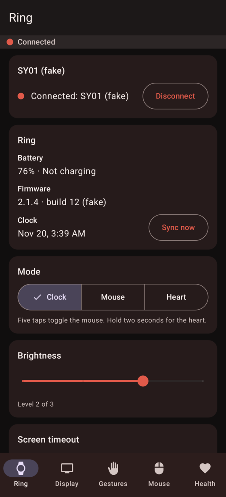
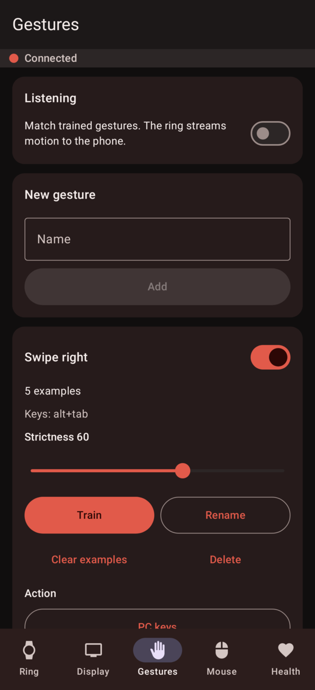

# smart-ring-repacker

Open-source Android app, local API and custom-firmware toolchain for the **SY01 smart ring** (a PixArt-based ring sold with the RWFit app).
Replace the vendor app, turn the ring's touch pad into a programmable input device, stream its accelerometer, and build on it. Designed so other rings can be added.

| | |
|---|---|
|  |  |

*Screenshots are from the app running against the built-in fake ring.*

> **Works with:** [gaze-keyboard](https://github.com/TheInsidiousMachine/gaze-keyboard), a gaze-glide keyboard for Everysight glasses that uses this ring as its button
> over `WS /v1/events` (touch `HOLD_START` / `TAP` / `HOLD_END`). Integration contract: [docs/INTEGRATION.md](docs/INTEGRATION.md).

## What it does

Works on **stock** firmware:
- Connect, battery, firmware version, clock, display brightness and screen timeout, find-ring, ring-touch to phone HID modes (clicker / pages / music).

Needs our **optional custom firmware** ([docs/FIRMWARE.md](docs/FIRMWARE.md), you flash your own ring, brick risk):
- Touch events with press/release edges and a ring-side timestamp (the stock ring reports no hold event).
- Tilt-controlled HID mouse (pointer or joystick), tap = click, hold-still = right click.
- Raw accelerometer stream (~99 Hz) to the phone, **Gesture Studio** (train your own motion gestures on the phone, trigger webhooks, ring text, media keys, PC key combos), and an on-ring bump-bump-flick message.
- Clock page, 5-character LED text, heart-rate beat detection (**unverified** on a worn ring), "keys" mode for external keyboard apps.
- Step counting, sleep and SpO2 are **removed** by our firmware.

Always:
- Local **HTTP + WebSocket API** ([docs/API.md](docs/API.md)) with bearer-token auth, and a Linux PC bridge ([pc/](pc/README.md)).
- Python BLE client and parsers, a protocol write-up ([docs/PROTOCOL.md](docs/PROTOCOL.md)), firmware analysis, an emulator-based firmware test gate.

## Supported hardware

| Ring | Status |
|---|---|
| **SY01** (model 30330000, firmware V2.1.4) | **Verified** on real hardware (stock firmware features and our custom builds up to 14; later builds tested only on host and emulator, see [docs/STATUS.md](docs/STATUS.md)) |
| Colmi R02-R09 family | **Not implemented.** Public protocol outline in [docs/ADDING_A_RING.md](docs/ADDING_A_RING.md), unverified (we have no Colmi ring). These rings have no touch-hold events, so they cannot be the gaze-keyboard button. |
| Anything else | Not yet. Open a "new ring support" issue. |

## 5-minute quickstart

You need an Android phone (8.0+), a SY01 ring, JDK 17 or 21 and the Android SDK (platform 35).

```bash
git clone https://github.com/TheInsidiousMachine/smart-ring-repacker && cd smart-ring-repacker/android
export JAVA_HOME=/path/to/jdk-21 ANDROID_HOME=$HOME/Android/Sdk
./gradlew assembleDebug
adb install -r app/build/outputs/apk/debug/app-debug.apk
```

1. Close the vendor app (RWFit); a ring talks to one app at a time. Tap the ring to wake it.
2. Open **Ring**, grant the Bluetooth permission, tap **Connect**. The app looks for a device named `SY01`. You should see battery and firmware version.
3. Enable the API: **Gestures** tab -> API card -> switch on, note the URL and token. Try it:
   ```bash
   curl -H "Authorization: Bearer <token>" http://<phone-ip>:8765/v1/status
   ```
4. Stream touch events: `websocat "ws://<phone-ip>:8765/v1/events?token=<token>"`. Touch events need custom firmware.

Details: [docs/BUILDING.md](docs/BUILDING.md), [docs/APP_GUIDE.md](docs/APP_GUIDE.md). Verification status of every claim: [docs/STATUS.md](docs/STATUS.md).

## Docs

| | |
|---|---|
| [ARCHITECTURE](docs/ARCHITECTURE.md) | layers, data flow, firmware layers |
| [API](docs/API.md) | HTTP and WebSocket reference, event kinds |
| [PROTOCOL](docs/PROTOCOL.md) | BLE protocol with confidence labels, custom `0x7A` group |
| [GESTURES](docs/GESTURES.md) | touch events, bump-bump-flick, Gesture Studio |
| [FIRMWARE](docs/FIRMWARE.md), [ROLLBACK](docs/OTA_ROLLBACK_CHECKLIST.md), [ANALYSIS](docs/FIRMWARE_ANALYSIS.md) | **read before flashing** |
| [ADDING_A_RING](docs/ADDING_A_RING.md) | implement `RingController` for another ring |
| [INTEGRATION](docs/INTEGRATION.md) | using the ring from other projects (gaze-keyboard) |
| [TESTING](docs/TESTING.md), [BUILDING](docs/BUILDING.md), [CONTRIBUTING](CONTRIBUTING.md), [ROADMAP](docs/ROADMAP.md), [CHANGELOG](CHANGELOG.md) | |

AI coding agents: start at [AGENTS.md](AGENTS.md).

## Safety and legal

- Use it with **your own ring and phone**. Do not use it against devices you do not own.
- **Firmware can brick your ring.** No recovery from a bad image has been demonstrated. Everything except flashing works without it. Read [docs/FIRMWARE.md](docs/FIRMWARE.md) and the rollback checklist first.
- The vendor app, vendor firmware and vendor native libraries are **not** included and must not be committed; you supply your own copy of the firmware image for the builder. See [THIRD_PARTY.md](THIRD_PARTY.md).
- Not affiliated with or endorsed by the ring's manufacturer, RWFit, PixArt, JieLi, LinkedSemi or Colmi. Provided as is, without warranty.
- The local API is plain HTTP; anyone on your network with the token can control the ring. See [SECURITY.md](SECURITY.md).

## Licence

MIT for original code ([LICENSE](LICENSE)). Third-party components and what is deliberately not included: [THIRD_PARTY.md](THIRD_PARTY.md).
