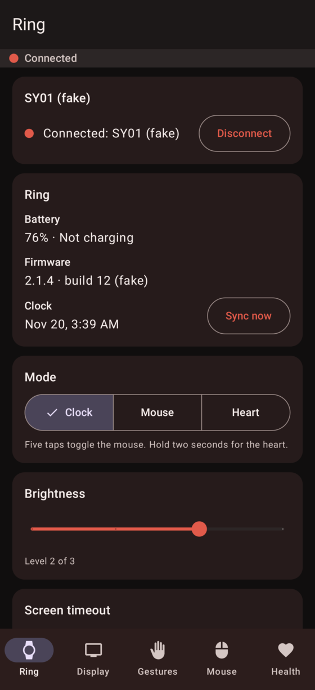
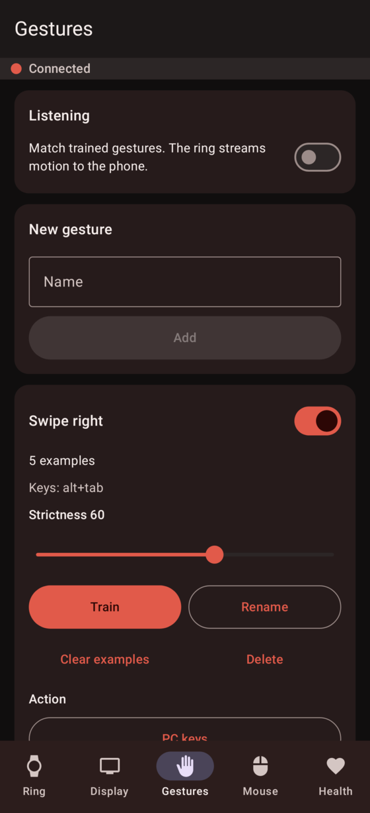
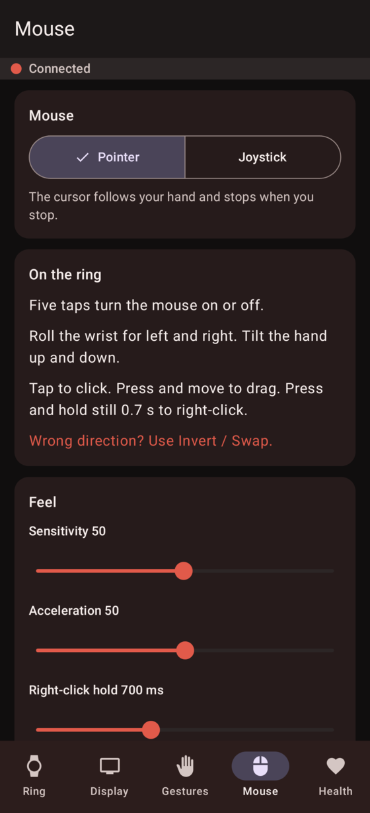
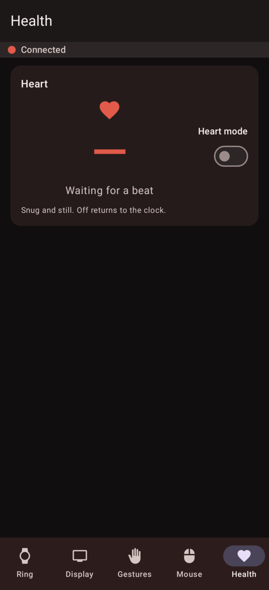

# App guide

One Jetpack Compose (Material 3) activity, dark-first with a light theme that follows the system. Bottom navigation: Ring, Display,
Gestures, Mouse, Health. Screenshots are from the app running on the built-in fake ring, not on hardware.

| Tab | What it does |
|---|---|
|  **Ring** | Connect/disconnect, battery, firmware and build, clock sync, mode (Clock / Mouse / Heart / Keys), brightness 0..3, screen timeout, find ring. A status pill under the title shows Connected / Reconnecting / Disconnected on every tab. |
| **Display** | The bump-bump-flick message: live preview of the 5-character LED display, text, preset chips, Scroll or Words, speed (Fast/Normal/Slow + slider), plays, send, play now, detector on/off, fired/armed counters, saved "show now" messages. |
|  **Gestures** | Listening switch, new gesture, per-gesture training, strictness, action editor, recognised-gesture feed, and the local API card (enable, port, LAN, token, URLs). |
|  **Mouse** | Pointer (cursor follows changes in hand angle, stops when you stop) or Joystick (held tilt keeps moving); sensitivity, acceleration, invert X/Y, swap axes, right-click hold. Deadzone and recenter appear for Joystick. |
|  **Health** | Heart mode switch and a live BPM readout from the ring's PPG sensor. |

Heart mode: **unverified** on a worn ring in the latest builds; earlier tuning used synthetic data and a capture that may not have been worn.

## Developer mode

Ring tab -> Dev mode switch. Each tab then gets a collapsed developer section (raw status, recorder with live samples/s, recent events),
and the top bar opens a console: filtered log, copy, a raw hex command line (`group key flag payload`, e.g. `02 04 10`) and canned stock
commands. The Ring tab also shows the **firmware update** card (hash-gated, see [FIRMWARE.md](FIRMWARE.md)) and power off.
Factory restore (`{2,34,0,2}`) is deliberately not offered.

The original Views-based screens (`HomeActivity`, `MainActivity` "Developer tools") are still in the manifest as non-launcher activities; the Compose app
(`RingAppActivity`) is the launcher.

Session logs: every session is captured raw (TX/RX hex, console, MARK lines) to `Android/data/com.smartring.testbed/files/sessions/*.tsv` on the phone.
Motion recordings go to `files/recordings/<label>_<time>.csv`.

## What is not in the UI

Stock tap-pattern rules (double/triple tap -> action), stock title+body message push (the SY01 ignores it), and the JieLi auth probe
are not exposed in the Compose app. The mouse curve graphs are sketches, not the firmware's exact function.
